<!-- Custom Header Banner -->

  

 

<!-- Animated Typing SVG (Brushed Gold #D4AF37) -->

  

 

<!-- Dark Luxury GitHub Badges (Followers, Stars, Views) -->

  
  
  

 

 

<!-- About Me Section (65% Text / 35% Image) -->
<h2 align="center">About Me</h2>

<table align="center" width="100%">
  <tr>
    <td width="65%" valign="middle">
      

        Hi, I'm <b>Yash Raool</b> — a <b>Full-Stack Web Developer</b> and <b>AI-assisted vibe coder</b> focused on shipping sleek, high-performance web applications with smooth interactions and modern aesthetics.
      

      <ul>
        <li><b>Currently building:</b> Full-stack web apps, clean UI systems, and AI-powered workflows with Google Antigravity, Claude Code, and ChatGPT.</li>
        <li><b>Currently exploring:</b> Scalable backend architectures, interactive 3D web experiences, and cloud deployments on AWS & Render.</li>
        <li><b>Open to collaborating on:</b> Innovative web apps, startup MVPs, and creative frontend projects.</li>
        <li><b>Ask me about:</b> React, Next.js, Node.js, Python, Tailwind CSS, and AI development workflows.</li>
        <li><b>Off the clock:</b> Clean minimalism, Formula 1 weekends, and great anime.</li>
        <li><b>Reach me at:</b> <a href="mailto:yashhraool9@gmail.com">yashhraool9@gmail.com</a></li>
      </ul>
    </td>
    <td width="35%" align="center" valign="middle">
      
    </td>
  </tr>
</table>

 

 

<!-- Centered Tech Stack & Tools -->
<h2 align="center">Tech Stack & Tools</h2>

  
<b>Languages</b>

  <a href="https://github.com/YashRaool">
    <picture>
      <source media="(prefers-color-scheme: dark)" srcset="https://skillicons.dev/icons?i=py,js,ts,html,css,c&theme=dark" />
      <source media="(prefers-color-scheme: light)" srcset="https://skillicons.dev/icons?i=py,js,ts,html,css,c&theme=light" />
      
    </picture>
  </a>

  
<b>Frontend & Web Frameworks</b>

  <a href="https://github.com/YashRaool">
    <picture>
      <source media="(prefers-color-scheme: dark)" srcset="https://skillicons.dev/icons?i=react,nextjs,tailwind,vite,threejs&theme=dark" />
      <source media="(prefers-color-scheme: light)" srcset="https://skillicons.dev/icons?i=react,nextjs,tailwind,vite,threejs&theme=light" />
      
    </picture>
  </a>

  
<b>Backend & Databases</b>

  <a href="https://github.com/YashRaool">
    <picture>
      <source media="(prefers-color-scheme: dark)" srcset="https://skillicons.dev/icons?i=nodejs,express,prisma,mongodb,postgres&theme=dark" />
      <source media="(prefers-color-scheme: light)" srcset="https://skillicons.dev/icons?i=nodejs,express,prisma,mongodb,postgres&theme=light" />
      
    </picture>
  </a>

  
<b>Cloud, Deployment & Developer Tools</b>

  <a href="https://github.com/YashRaool">
    <picture>
      <source media="(prefers-color-scheme: dark)" srcset="https://skillicons.dev/icons?i=aws,vercel,git,github,githubactions,vscode,postman,figma,npm&theme=dark" />
      <source media="(prefers-color-scheme: light)" srcset="https://skillicons.dev/icons?i=aws,vercel,git,github,githubactions,vscode,postman,figma,npm&theme=light" />
      
    </picture>
  </a>

  
<b>AI Workflow & Platforms</b>

  
  
  
  

 

 

<!-- GitHub Streak + Activity Graph (Dark Luxury Theme: #000000, #D4AF37, #CCFF00, #FFFFFF, #B8B8B8) -->
<h2 align="center">GitHub Stats & Activity</h2>

  

 

  

 

 

<!-- Contribution Snake Section -->
<h2 align="center">Contribution Snake</h2>

  <picture>
    <source media="(prefers-color-scheme: dark)" srcset="https://raw.githubusercontent.com/YashRaool/YashRaool/output/github-contribution-grid-snake-dark.svg" />
    <source media="(prefers-color-scheme: light)" srcset="https://raw.githubusercontent.com/YashRaool/YashRaool/output/github-contribution-grid-snake.svg" />
    
  </picture>

 

 

<!-- Connect With Me Section -->
<h2 align="center">Connect With Me</h2>

  
  
  
  

 

<!-- Matte Black & Gold Capsule Render Waving Footer -->

  

